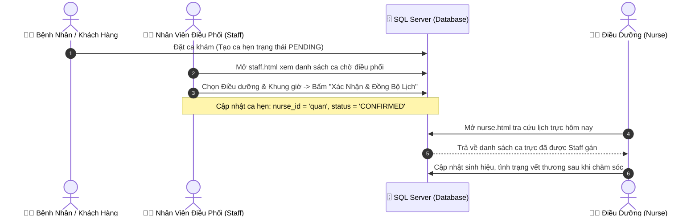

# 🏥 TÀI LIỆU HƯỚNG DẪN HỌP NHÓM & PHÂN CHIA CÔNG VIỆC DỰ ÁN BBCARE

> **Dự án:** BBCare Homecare - Nền Tảng Chăm Sóc Sức Khỏe & Quản Lý Ca Trực Tại Nhà  
> **Repository GitHub:** [https://github.com/bao2006dna-oss/BBCARE](https://github.com/bao2006dna-oss/BBCARE)  
> **Tech Stack:** Spring Boot 3.3.4 (JDK 21) • Microsoft SQL Server • Spring Data JPA • Thymeleaf • Vanilla CSS/JS  

---

## 🧭 PHẦN 1: HỆ THỐNG ĐI NHƯ THẾ NÀO? (LUỒNG NGHIỆP VỤ TỔNG THỂ)



### 🔑 Trọng tâm đồng bộ dữ liệu:
- **Bảng trung tâm:** `appointments` (Ca hẹn) liên kết khóa ngoại `@ManyToOne` với bảng `nurses` (Điều dưỡng).
- **Nguyên lý đồng bộ:** Khi **Staff** gán hoặc đổi lịch hẹn trong `staff.html`, dữ liệu ghi thẳng vào SQL Server. Ngay lập tức **Điều dưỡng** mở `nurse.html` lên sẽ thấy ca trực của mình được cập nhật theo thời gian thực.

---

## 🌿 PHẦN 2: QUY TRÌNH TÁCH NHÁNH GIT (GIT WORKFLOW)

Để không bao giờ bị conflict (xung đột code), nhóm thực hiện nghiêm ngặt quy trình:

### 1. Kéo code mới nhất về máy:
```bash
git clone https://github.com/bao2006dna-oss/BBCARE.git
cd BBCARE
git checkout main
git pull origin main
```

### 2. Tách nhánh làm việc riêng:
- **Bạn làm phần Staff:**
  ```bash
  git checkout -b feature/staff-appointment
  ```
- **Bạn làm phần Điều dưỡng (Nurse):**
  ```bash
  git checkout -b feature/nurse-schedule
  ```

### 3. Nguyên tắc Commit & Push:
- **KHÔNG DÙNG `git add .` bừa bãi!**
- Chỉ `git add` đúng các file Java/JS của chức năng mình phụ trách:
  ```bash
  git add src/main/java/.../TenFileCuaBan.java
  git commit -m "feat: hoàn thành API xem ca trực theo ngày"
  git push -u origin feature/ten-nhanh-cua-ban
  ```
- Lên GitHub tạo **Pull Request (PR)** gộp vào `main`.

---

## 👥 PHẦN 3: CHI TIẾT PHÂN CHIA THEO TỪNG ACTOR

---

### 🅰️ ACTOR 1: NHÂN VIÊN VẬN HÀNH & ĐIỀU PHỐI (STAFF)
* **Giao diện phụ trách:** 
  - `src/main/resources/templates/staff.html`
  - `src/main/resources/static/js/staff/staff.js`
  - `src/main/resources/static/js/portal.js`

* **Các Class Backend cần làm:**
  1. `model/Appointment.java` (Entity ca hẹn, quan hệ `@ManyToOne Nurse`)
  2. `repository/AppointmentRepository.java` (Truy vấn ca hẹn, check trùng ca)
  3. `service/AppointmentService.java` (Nghiệp vụ gán ca, đổi lịch)
  4. `controller/AppointmentApiController.java` (REST API cho Staff)

* **Danh sách API cần cung cấp:**

| Phương thức | Đường dẫn API | Mô tả chức năng | Request Body / Params |
| :--- | :--- | :--- | :--- |
| `GET` | `/api/appointments` | Lấy tất cả lịch hẹn | Không có |
| `GET` | `/api/appointments/by-date` | Lọc ca theo ngày | `?date=2026-10-11` |
| `POST` | `/api/appointments/{id}/assign` | **Gán ĐD / Đổi ca trực (Nút Xác nhận & Đồng bộ)** | JSON: `{"nurseId": "quan", "newDate": "2026-10-11", "newSlot": "14:00 - 16:30 (Chiều)", "reason": "Đổi ca"}` |
| `GET` | `/api/appointments/check-conflict` | Kiểm tra ĐD có bận giờ đó không | `?nurseId=quan&date=2026-10-11&slot=...` |

* **Cách kết nối Javascript trên `staff.html`:**
  Tìm hàm `submitChangeAppointment(event)` trong `portal.js` và thay đoạn cập nhật mảng ảo bằng lệnh `fetch`:
  ```javascript
  // Gửi dữ liệu điều phối ca trực xuống Spring Boot:
  fetch(`/api/appointments/${aptId}/assign`, {
      method: 'POST',
      headers: { 'Content-Type': 'application/json' },
      body: JSON.stringify({
          nurseId: document.getElementById('aptNewNurse').value,
          newDate: document.getElementById('aptNewDate').value,
          newSlot: document.getElementById('aptNewTimeSlot').value,
          reason: document.getElementById('aptChangeReason').value
      })
  })
  .then(res => res.json())
  .then(data => {
      showToast(data.message, 'success');
      closeModal('changeAppointmentModal');
      loadAppointmentsList(); // Load lại bảng
  });
  ```

---

### 🅱️ ACTOR 2: ĐIỀU DƯỠNG VIÊN (NURSE)
* **Giao diện phụ trách:** 
  - `src/main/resources/templates/nurse.html`
  - `src/main/resources/static/js/nurse/nurse.js`

* **Các Class Backend cần làm:**
  1. `model/Nurse.java` (Entity thông tin điều dưỡng, chuyên môn, khu vực, sao đánh giá)
  2. `repository/NurseRepository.java` (Tìm theo tên, quận huyện)
  3. `service/NurseService.java` (Lấy hồ sơ, danh sách ĐD)
  4. `controller/NurseApiController.java` (REST API cung cấp dữ liệu cho Nurse Portal)

* **Danh sách API cần cung cấp:**

| Phương thức | Đường dẫn API | Mô tả chức năng | Request Body / Params |
| :--- | :--- | :--- | :--- |
| `GET` | `/api/nurses` | Lấy danh sách tất cả ĐD (Đổ vào dropdown Staff & Khách xem) | Không có |
| `GET` | `/api/nurses/{id}` | Lấy chi tiết hồ sơ 1 ĐD (Bằng cấp, kỹ năng, số sao) | Đường dẫn: `/api/nurses/quan` |
| `GET` | `/api/nurses/search` | Tìm kiếm ĐD theo tên (Cho ô search nhanh) | `?q=Minh` |
| `GET` | `/api/appointments/by-nurse` | **Xem tờ lịch trực ca trong ngày của ĐD** | `?nurseId=quan&date=2026-10-11` |

* **Cách kết nối Javascript trên `nurse.html`:**
  Trong `nurse.js`, viết hàm load lịch trực từ Backend khi ĐD mở màn hình:
  ```javascript
  function loadMySchedule(nurseId, date) {
      fetch(`/api/appointments/by-nurse?nurseId=${nurseId}&date=${date}`)
          .then(res => res.json())
          .then(myShifts => {
              renderNurseTimeline(myShifts); // Vẽ các ca trực lên tờ lịch cá nhân
          });
  }
  ```

---

## 🤖 PHẦN 4: BỘ PROMPT AI "COPY & PASTE" CHO TỪNG BẠN

Khi làm việc, mỗi bạn chỉ cần **copy nguyên văn câu prompt dưới đây dán cho AI** để AI sinh code chuẩn 100% không bị lệch cấu trúc:

---

### 🎯 Prompt dành cho bạn làm ACTOR STAFF (Lịch Hẹn & Điều Phối):
```text
Tôi đang làm dự án Spring Boot 3 (JDK 21, SQL Server, Spring Data JPA) quản lý y tế BBCare.
Package chính của dự án: com.example.demo

Tôi phụ trách Actor STAFF (Nhân Viên Điều Phối Ca Trực).
Tôi cần bạn viết/hoàn thiện các class sau:
1. model/Appointment.java: Khóa chính id (Long), code (String), patientName, patientPhone, patientAddress, serviceName, appointmentDate, timeSlot, status ('pending', 'confirmed', 'completed'), reason, price. Có quan hệ @ManyToOne với Nurse (khóa ngoại nurse_id).
2. repository/AppointmentRepository.java:
   - findByAppointmentDate(String date)
   - findByNurseIdAndAppointmentDate(String nurseId, String date)
   - boolean existsByNurseIdAndAppointmentDateAndTimeSlot(String nurseId, String date, String slot)
3. service/AppointmentService.java:
   - getAllAppointments()
   - assignOrUpdateAppointment(Long id, String nurseId, String newDate, String newSlot, String reason): Kiểm tra nếu trùng ca của điều dưỡng khác thì ném Exception, ngược lại cập nhật ca và lưu DB.
4. controller/AppointmentApiController.java:
   - GET /api/appointments
   - GET /api/appointments/by-date?date=...
   - POST /api/appointments/{id}/assign (Nhận JSON: nurseId, newDate, newSlot, reason) trả về status success/error.

Hãy viết code chuẩn Java 21, sử dụng Spring Data JPA, không dùng Lombok (dùng Getter/Setter chuẩn).
```

---

### 🎯 Prompt dành cho bạn làm ACTOR ĐIỀU DƯỠNG (Hồ Sơ & Lịch Trực):
```text
Tôi đang làm dự án Spring Boot 3 (JDK 21, SQL Server, Spring Data JPA) quản lý y tế BBCare.
Package chính của dự án: com.example.demo

Tôi phụ trách Actor ĐIỀU DƯỠNG (Nurse).
Tôi cần bạn viết/hoàn thiện các class sau:
1. model/Nurse.java: id (String, ví dụ 'quan', 'minh'), code (String, 'DD01'), fullName (String), specialty (String), district (String), phone (String), avatar (String), ratingAvg (Double), reviewsCount (Integer), status (String 'ACTIVE').
2. repository/NurseRepository.java:
   - findByFullNameContainingIgnoreCase(String keyword)
   - findByDistrictContainingIgnoreCase(String district)
3. service/NurseService.java:
   - getAllNurses()
   - getNurseById(String id)
   - searchNursesByName(String keyword)
4. controller/NurseApiController.java:
   - GET /api/nurses: trả về danh sách tất cả điều dưỡng
   - GET /api/nurses/{id}: trả về chi tiết 1 điều dưỡng
   - GET /api/nurses/search?q=...: tìm kiếm điều dưỡng theo tên

Hãy viết code chuẩn Java 21, Spring Data JPA, không dùng Lombok (dùng Getter/Setter chuẩn).
```

---

### 🎯 Prompt kết nối Frontend Javascript với API Spring Boot:
```text
Tôi có giao diện HTML/JavaScript thuần và Backend Spring Boot chạy tại port 8080.
Hãy viết giúp tôi đoạn code JavaScript dùng Fetch API để:
1. Khi trang tải lên: Gọi GET /api/nurses để đổ danh sách điều dưỡng vào thẻ <select id="aptNewNurse">.
2. Khi người dùng bấm nút "Xác Nhận & Đồng Bộ Lịch": Lấy dữ liệu từ form (aptId, aptNewNurse, aptNewDate, aptNewTimeSlot, aptChangeReason) và gọi POST /api/appointments/{id}/assign bằng JSON.
3. Nếu thành công: Hiển thị thông báo toast thành công và đóng modal. Nếu thất bại (trùng ca): Báo lỗi lên màn hình.
```

---

## 🏁 BẢNG TỔNG KẾT NHIỆM VỤ ĐỒNG BỘ TRONG CUỘC HỌP

| Thành viên | Nhánh Git | Phụ trách chính | File trọng tâm | Mục tiêu hoàn thành |
| :--- | :--- | :--- | :--- | :--- |
| **Bạn 1 (Staff Lead)** | `feature/staff-appointment` | Quản lý lịch hẹn, điều phối gán ca, check trùng ca trực | `Appointment.java`, `AppointmentService.java`, `AppointmentApiController.java`, `staff.html` | Staff đổi ca thì SQL Server lưu ngay ca đó |
| **Bạn 2 (Nurse Lead)** | `feature/nurse-schedule` | Quản lý hồ sơ điều dưỡng, xem tờ lịch trực cá nhân | `Nurse.java`, `NurseService.java`, `NurseApiController.java`, `nurse.html` | Điều dưỡng mở app thấy ngay ca được Staff gán |

*Tài liệu này được lưu trực tiếp tại file `HUONG_DAN_PHAN_CHIA_NHOM.md` trong mã nguồn dự án để cả nhóm cùng đọc và thực hiện.*
